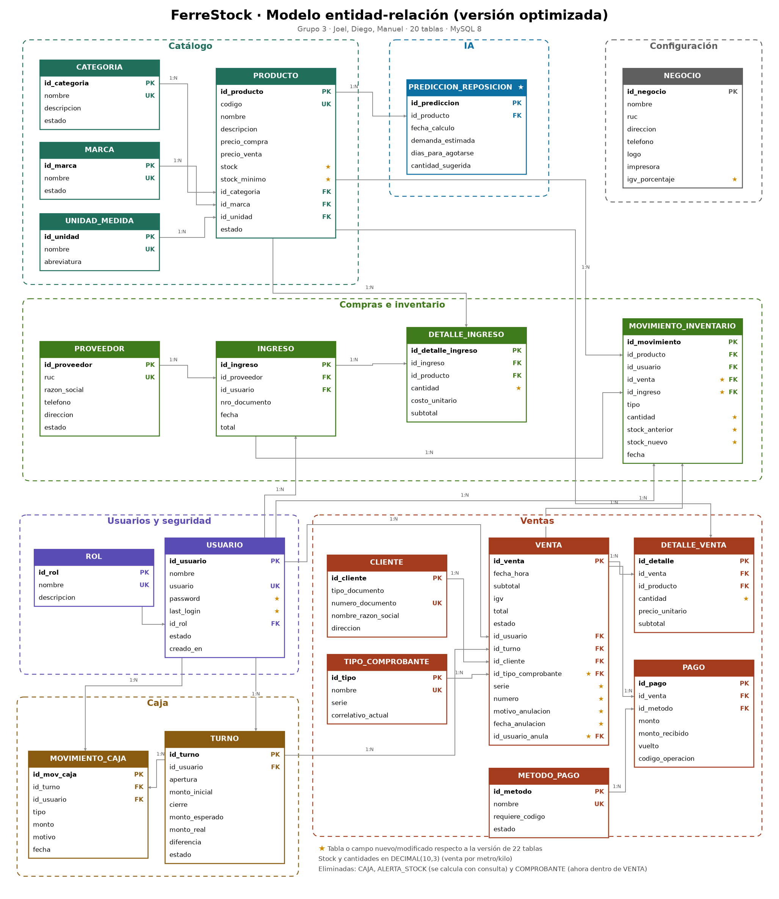

# FerreStock

Sistema web y móvil de **punto de venta (POS) e inventario** para una ferretería en Perú: ventas con IGV 18 %, pagos con Efectivo, Yape y Plin, boletas y facturas, control de stock, cierre de caja, reportes y predicción de reposición con IA.

Proyecto Integrador · 4.º ciclo · **Tecsup** · Diseño y Desarrollo de Software · 2026-2

| Integrante | Rol Scrum |
|---|---|
| Juan Diego Ramos Enriquez | Product Owner |
| Manuel Gerardo Salazar Ambrosio | Scrum Master |
| Joel Facundo Quijada Zevallos | Equipo de desarrollo |

Cursos que integra: Construcción y Pruebas de Software · Desarrollo de Aplicaciones Web · Desarrollo de Aplicaciones Empresariales · Programación en Móviles.

---

## 1. Arquitectura

```
 ADMINISTRACIÓN
 React admin ──── REST + JWT ────► Django ──────────────┐
                                    (dueño del esquema) │
                                                        ├──► MySQL 8 (20 tablas)
 USUARIO                                                │
 POS React  ──┐                                         │
              ├── REST + JWT ────► Spring Boot ─────────┘
 App Kotlin ──┘                    (solo valida las tablas)
```

| Componente | Tecnología | Usuarios | Curso |
|---|---|---|---|
| `admin-backend-django` | Django 6.1 + Django REST Framework | — | Desarrollo de Aplicaciones Web |
| `admin-frontend-react` | React 19 + Vite | Administrador | Desarrollo de Aplicaciones Web |
| `pos-backend-springboot` | Spring Boot 4.1 + Java 21 | — | Desarrollo de Aplicaciones Empresariales |
| `pos-frontend-react` | React 19 + Vite | Cajero | Desarrollo de Aplicaciones Empresariales |
| `app-movil-kotlin` | Kotlin + Jetpack Compose | Vendedor en tienda | Programación en Móviles |
| Base de datos | MySQL 8 | — | Todos |

**Reglas de la arquitectura**

- **Una sola base de datos** (MySQL 8) para todo el sistema.
- **Django es el dueño del esquema:** solo sus migraciones crean o modifican tablas. Spring Boot usa `ddl-auto=validate`, así que solo verifica que existan.
- **Login único:** Django emite el token JWT; Spring Boot lo valida con el mismo secreto. El rol del usuario viaja dentro del token.
- **Quién escribe qué:** Django → usuarios, catálogo, ingresos de mercadería, negocio e IA. Spring Boot → ventas, pagos, turnos y movimientos de caja.
- **Stock:** todo cambio va dentro de una transacción, con bloqueo de fila (`SELECT … FOR UPDATE`) y registro en el kárdex.
- **La app Kotlin nunca se conecta directo a MySQL:** todo lo pide a Spring Boot.

---

## 2. Estructura del repositorio

```
FerreStock/
├── README.md
├── .gitignore
│
├── database/
│   ├── diagrama-er.png          ← modelo entidad-relación (20 tablas)
│   └── seeds.sql                ← datos iniciales: roles y unidades de medida
│
├── admin-backend-django/        ← ADMINISTRACIÓN · API REST
│   ├── manage.py
│   ├── requirements.txt
│   ├── config/                  ← settings, urls
│   └── apps/
│       ├── usuarios/            ← rol, usuario, login JWT
│       ├── catalogo/            ← categoría, marca, unidad de medida, producto   (HU-01, HU-04)
│       ├── inventario/          ← proveedor, ingreso, kárdex, alertas            (HU-02, HU-09)
│       ├── ventas/              ← venta, detalle, pago, cliente… (solo esquema)
│       ├── caja/                ← turno, movimiento de caja (solo esquema)
│       ├── reportes/            ← reporte diario y PDF                           (HU-10, HU-12)
│       ├── configuracion/       ← datos del negocio
│       └── ia/                  ← predicción de reposición                       (HU-13)
│
├── admin-frontend-react/        ← panel del administrador (React + Vite)
│
├── pos-backend-springboot/      ← USUARIO · API de ventas
│   ├── pom.xml
│   └── src/main/java/pe/ferrestock/pos/
│
├── pos-frontend-react/          ← POS del cajero (React + Vite)
│
├── app-movil-kotlin/            ← app Android (Kotlin + Compose)
│   └── app/src/main/java/pe/ferrestock/app/
│
└── docs/
    ├── scrum/sprint-1 … sprint-4/   ← sprint board, burndown, evidencias
    └── monografia/
```

Las subcarpetas internas de cada proyecto (`api/`, `pages/`, `entity/`, `service/`, `viewmodel/`, etc.) se agregan a medida que se desarrollan las historias de usuario de cada sprint.

---

## 3. Base de datos

**Motor:** MySQL 8 · **Base:** `ferrestock` · **Codificación:** `utf8mb4` · **Nombres:** minúscula y `snake_case`.



### 3.1 Entidades (20 tablas en 7 módulos)

| Módulo | Tabla | Qué guarda | App Django |
|---|---|---|---|
| **Usuarios y seguridad** | `rol` | Roles: ADMINISTRADOR y CAJERO | `usuarios` |
| | `usuario` | Usuarios del sistema, contraseña con hash | `usuarios` |
| **Catálogo** | `categoria` | Categorías de productos | `catalogo` |
| | `marca` | Marcas | `catalogo` |
| | `unidad_medida` | Unidad, metro, kilogramo, caja, galón | `catalogo` |
| | `producto` | Código, precios, stock y stock mínimo | `catalogo` |
| **Compras e inventario** | `proveedor` | Proveedores con RUC | `inventario` |
| | `ingreso` | Cabecera de cada ingreso de mercadería | `inventario` |
| | `detalle_ingreso` | Productos y cantidades de cada ingreso | `inventario` |
| | `movimiento_inventario` | Kárdex: cada entrada, salida o ajuste de stock | `inventario` |
| **Ventas** | `cliente` | Clientes con DNI o RUC (para facturas) | `ventas` |
| | `tipo_comprobante` | Boleta (B001) y factura (F001), con su correlativo | `ventas` |
| | `metodo_pago` | Efectivo, Yape, Plin | `ventas` |
| | `venta` | Cabecera de la venta, incluye datos del comprobante y de la anulación | `ventas` |
| | `detalle_venta` | Productos vendidos con el precio del momento | `ventas` |
| | `pago` | Pagos de cada venta (permite pagos mixtos) | `ventas` |
| **Caja** | `turno` | Apertura y cierre de caja de cada cajero | `caja` |
| | `movimiento_caja` | Ingresos y egresos de dinero del turno | `caja` |
| **Configuración** | `negocio` | Nombre, RUC, logo, ticketera, porcentaje de IGV | `configuracion` |
| **IA** | `prediccion_reposicion` | Demanda estimada, días para agotarse y cantidad sugerida | `ia` |

### 3.2 Relaciones principales

| Padre | Hijo | Tipo |
|---|---|---|
| rol | usuario | 1:N |
| categoria / marca / unidad_medida | producto | 1:N |
| proveedor | ingreso | 1:N |
| ingreso | detalle_ingreso | 1:N |
| producto | detalle_ingreso, detalle_venta, movimiento_inventario, prediccion_reposicion | 1:N |
| usuario | ingreso, turno, venta, movimiento_inventario, movimiento_caja | 1:N |
| turno | venta, movimiento_caja | 1:N |
| cliente | venta | 1:N (opcional, para facturas) |
| tipo_comprobante | venta | 1:N |
| venta | detalle_venta, pago, movimiento_inventario | 1:N |
| ingreso | movimiento_inventario | 1:N |
| metodo_pago | pago | 1:N |

### 3.3 Decisiones de diseño

- **Stock y cantidades en `DECIMAL(10,3)`:** la ferretería vende por metro y por kilo (por ejemplo, 2.5 m de cable).
- **El comprobante va dentro de `venta`** (tipo, serie y número), porque cada venta tiene exactamente uno.
- **Las alertas de stock bajo se calculan con una consulta** (`stock <= stock_minimo`) en lugar de guardarse en una tabla, así nunca quedan desactualizadas.
- **El kárdex referencia la venta o el ingreso** que originó cada movimiento (`id_venta`, `id_ingreso`).
- **El IGV es configurable** desde `negocio.igv_porcentaje` (18 %).
- **Anulación, no borrado:** una venta anulada guarda el motivo, la fecha y quién la anuló.
- **Borrado lógico:** catálogos, productos, usuarios y proveedores se desactivan con `estado = 0`.
- **Precio histórico:** `detalle_venta.precio_unitario` guarda el precio del momento de la venta.

### 3.4 Cómo se crean las tablas

Las tablas **no se crean con un script SQL a mano**: se definen como modelos en el `models.py` de cada app de Django y se generan con las migraciones.

```
models.py  →  python manage.py makemigrations  →  python manage.py migrate  →  tablas en MySQL
```

Además de las 20 tablas del proyecto, Django crea sus tablas internas (`django_migrations`, `django_session`, `auth_permission`, etc.).

---

## 4. Cómo se creó la estructura base

| Proyecto | Cómo se creó |
|---|---|
| `admin-backend-django` | `python -m venv venv` → `pip install django djangorestframework djangorestframework-simplejwt django-cors-headers pymysql python-dotenv` → `django-admin startproject config .` → `python manage.py startapp` para las 8 apps dentro de `apps/` |
| `admin-frontend-react` | `npm create vite@latest admin-frontend-react -- --template react` (con ESLint) |
| `pos-frontend-react` | `npm create vite@latest pos-frontend-react -- --template react` (con ESLint) |
| `pos-backend-springboot` | [start.spring.io](https://start.spring.io): Maven, Spring Boot 4.1.1, Java 21, paquete `pe.ferrestock.pos`, dependencias Spring Web, Spring Data JPA, MySQL Driver, Spring Security y Validation |
| `app-movil-kotlin` | Android Studio → Empty Activity (Compose), paquete `pe.ferrestock.app`, Minimum SDK 24, Kotlin DSL |

---

## 5. Requisitos para trabajar

| Herramienta | Versión |
|---|---|
| Git | 2.x |
| Python | 3.14 |
| Node.js | 24 LTS |
| JDK | 21 (el de IntelliJ o Eclipse Temurin) |
| MySQL | 9.2 (Django 6.1 exige 8.4 o superior) + MySQL Workbench 8.0 |
| IntelliJ IDEA | Para Spring Boot |
| Android Studio | Para la app Kotlin |

## 6. Cómo levantar cada proyecto

**Django** (puerto 8000)
```bat
cd admin-backend-django
python -m venv venv
venv\Scripts\activate
pip install -r requirements.txt
python manage.py runserver
```

**React admin y POS** (puerto 5173)
```bat
cd admin-frontend-react
npm install
npm run dev
```
(Lo mismo dentro de `pos-frontend-react`.)

### 6.1 Panel admin: Django y React a la vez

Son dos aplicaciones distintas que se comunican por HTTP, así que se abren **dos terminales**:

| Terminal 1 · Django (8000) | Terminal 2 · React (5173) |
|---|---|
| `cd admin-backend-django` | `cd admin-frontend-react` |
| `venv\Scripts\activate` | `npm run dev` |
| `python manage.py runserver` | Abrir http://localhost:5173 |

La dirección de la API se define una sola vez en `admin-frontend-react/.env` y la usa la instancia de Axios de `src/api/cliente.js` (con `timeout` de 10 s y el token JWT en cada petición):

```
VITE_API_URL=http://127.0.0.1:8000/api
```

### 6.2 Configuración de CORS

React (`localhost:5173`) y Django (`127.0.0.1:8000`) son orígenes distintos, por eso Django usa `django-cors-headers`:

- `corsheaders` en `INSTALLED_APPS` y `corsheaders.middleware.CorsMiddleware` en la parte alta de `MIDDLEWARE` (`config/settings.py`).
- Los orígenes permitidos se leen del `.env` de Django:

```
CORS_ALLOWED_ORIGINS=http://localhost:5173,http://localhost:5174
```

Si Vite arranca en otro puerto (5174, 5175…), el navegador bloquea las respuestas: libera el 5173 o agrega ese puerto a `CORS_ALLOWED_ORIGINS` y reinicia Django.

### 6.3 Endpoints que usa el panel

Todas requieren el token JWT (`Authorization: Bearer <token>`).

| Método | Endpoint | Uso en el panel |
|---|---|---|
| POST | `/api/auth/login/` · `/api/auth/refresh/` | Iniciar sesión y renovar el token |
| GET | `/api/catalogo/productos/?buscar=&categoria=&todos=1` | Listado con búsqueda y filtros |
| GET | `/api/catalogo/productos/{id}/` | Cargar un producto para editarlo |
| POST | `/api/catalogo/productos/` | Registrar producto (201 o 400 con errores) |
| PATCH | `/api/catalogo/productos/{id}/` | Editar o reactivar producto (200) |
| DELETE | `/api/catalogo/productos/{id}/` | Desactivar producto (204, borrado lógico) |
| GET | `/api/catalogo/categorias/` · `/marcas/` · `/unidades/` | Combos del formulario y filtro |
| GET · POST · PATCH · DELETE | `/api/catalogo/categorias/?search=` | Práctica del Laboratorio 12 (`/practica`) |
| GET | `/api/reportes/ventas/` · `/api/ventas/ventas/` · `/api/caja/turnos/` | Pantalla de reportes |
| GET | `/api/ventas/ventas/{id}/` | Detalle de una venta (cada cajero solo las suyas) |
| GET · POST | `/api/inventario/ingresos/` | Historial y registro de ingresos de mercadería |
| GET · POST · PATCH · DELETE | `/api/inventario/proveedores/` | Proveedores |
| GET | `/api/inventario/kardex/?producto=` | Kárdex (todo o de un producto) |
| GET · POST · PATCH · DELETE | `/api/usuarios/` · GET `/api/roles/` | Usuarios del personal |
| GET · PUT · PATCH | `/api/configuracion/negocio/` | Datos del negocio |
| GET | `/api/ia/predicciones/?dias_maximos=` | Predicción de reposición |

**Spring Boot** (puerto 8080): abrir `pos-backend-springboot` en IntelliJ y ejecutar `PosBackendSpringbootApplication`. Necesita MySQL configurado.

**App Kotlin:** abrir `app-movil-kotlin` en Android Studio y ejecutar en un emulador o celular.

---

## 7. Estado actual y siguientes pasos

- [x] Estructura base del monorepo con los 5 proyectos
- [x] Modelo entidad-relación de 20 tablas
- [x] MySQL configurado y Django conectado (`settings.py`, apps, idioma `es-pe`, zona `America/Lima`)
- [x] Modelos de usuarios y catálogo + primera migración + datos iniciales (`database/seeds.sql`)
- [x] Login con JWT (`/api/auth/login/`)
- [x] HU-01: API de productos con validaciones y pruebas automáticas
- [x] React admin: login JWT, layout estilo Industrial y pantalla de productos (HU-01)
- [ ] HU-05: carrito con IGV en el POS
- [ ] HU-11: reporte diario con desglose por tipo de pago
- [ ] Modelos de inventario, ventas, caja, configuración e IA

## 8. Forma de trabajo (Scrum + Git)

- Metodología **Scrum**: 4 sprints (semanas 7 a 15) con Sprint Board y Burndown en `docs/scrum/`.
- **Un commit por día**, con el código de la historia de usuario en el mensaje:
  `HU-05: calcula IGV en el carrito`.
- Una tarea está terminada solo si cumple la **Definition of Done**: código revisado, transacciones seguras, interfaz funcional, 100 % de los criterios de aceptación, probada en local y aprobada por el Product Owner.

---

## 9. Diseño de la aplicación

### 9.1 Tipo de comercio y canales

FerreStock es un comercio **B2C**: la ferretería vende al público (maestros de obra y vecinos) con boleta. También atiende ventas **B2B** cuando una empresa pide factura con RUC. La venta es presencial en la tienda y los canales son aplicaciones que usan la misma base de datos:

| Canal | Quién lo usa | API |
|---|---|---|
| Panel web (`admin-frontend-react`) | Administrador | Django |
| Punto de venta web (`pos-frontend-react`) | Cajero | Spring Boot |
| App móvil (`app-movil-kotlin`) | Administrador | Django |

### 9.2 Módulos

| Módulo | Qué hace | Estado |
|---|---|---|
| Catálogo | Productos, categorías, marcas y unidades | ✅ Hecho |
| Inventario | Proveedores, ingresos de mercadería tipo carrito y kárdex | ✅ Hecho |
| Usuarios y roles | Cuentas del personal (administrador y cajero) | ✅ Hecho · menú por rol en Semana 15 |
| Ventas | Carrito, IGV y comprobante | En el POS |
| Pagos | Efectivo, Yape y Plin | En el POS (Semana 16) |
| Caja | Apertura y cierre de turno | En el POS |
| Reportes | Ventas por periodo y por tipo de pago | ✅ Hecho |
| Predicción IA | Sugerencia de reposición | ✅ Pantalla hecha · falta el cálculo automático |
| Configuración | Datos del negocio, IGV y vista del comprobante | ✅ Hecho |
| Seguridad | Login JWT y permisos por rol | ✅ Login · 403 y 404 en Semana 15 |

### 9.3 Roles

El sistema tiene solo dos roles. Quien no inició sesión solo ve la pantalla de login.

| Rol | Qué puede hacer | Pantalla |
|---|---|---|
| Cajero (vendedor) | Vender, cobrar y cerrar caja. No entra al panel | POS |
| Administrador | Todo el panel: productos, catálogos, inventario, reportes, usuarios y configuración | Panel admin |

### 9.4 Requisitos

| ID | Descripción | Prioridad | Criterio de aceptación |
|---|---|---|---|
| RF01 | Registrar, editar y desactivar productos | Alta | Con código repetido o precio de venta 0 la API responde 400 |
| RF02 | Buscar productos por código o nombre y filtrar por categoría | Alta | `?buscar=` y `?categoria=` devuelven solo los que coinciden |
| RF03 | Registrar un ingreso de mercadería con varios productos | Alta | El stock de cada producto sube y se crea un movimiento ENTRADA en el kárdex |
| RF04 | Ver las ventas por periodo con el total por Efectivo, Yape y Plin | Media | La suma por método de pago es igual al total vendido |
| RF05 | Gestionar las cuentas del personal | Media | Un usuario que no es administrador recibe 403 |
| RNF01 | Seguridad | Alta | Toda petición sin token JWT válido responde 401 |
| RNF02 | Rendimiento | Media | El listado de productos responde en menos de 2 segundos en la red local |
| RNF03 | Usabilidad | Media | Cada pantalla muestra "Cargando…", un error o "lista vacía"; nunca queda en blanco |

### 9.5 Reglas de negocio

| Regla | Dónde se aplica | Qué error evita |
|---|---|---|
| El código del producto es único | Django (`validate_codigo`) | Dos productos con el mismo código |
| El precio de venta es mayor que 0 | React (formulario) y Django (`validate_precio_venta`) | Vender gratis por error |
| El precio de la venta se lee de la base de datos | Django (`VentaCreateSerializer`) | Que el navegador mande un precio cambiado |
| No se vende más de lo que hay en stock | Django (`select_for_update` en la transacción) | Stock negativo con dos ventas a la vez |
| El dinero se guarda como `Decimal` | Django (`DecimalField`) | Errores de redondeo de `float` |
| El ingreso tiene cantidad mayor que 0 y costo no negativo | Django (`DetalleIngresoInputSerializer`) | Ingresos vacíos o con costo negativo |
| Solo el administrador modifica el catálogo | React (`ROLES_PANEL`) y Django (`permissions.py`) | Que un cajero cambie precios |

### 9.6 Flujo principal del panel: ingreso de mercadería

```
Administrador
 → React: pantalla Inventario (pages)
 → Axios: api/inventario.js → POST /api/inventario/ingresos/ con el token JWT
 → Django: config/urls.py → apps/inventario/urls.py → IngresoListCreateView
 → IngresoSerializer: valida proveedor, productos, cantidades y costos
 → transacción: guarda Ingreso y DetalleIngreso, suma el stock y registra el kárdex (MovimientoInventario)
 → MySQL
 → Response 201 con el ingreso en JSON (o 400 con los errores)
 → React vuelve a dibujar la lista
```

Entidades: **Ingreso** (principal), **DetalleIngreso** (detalle), Proveedor, Producto y MovimientoInventario.

### 9.7 Estructura del panel

```
admin-backend-django/
├── config/          ← settings.py y urls.py del proyecto
└── apps/            ← usuarios, catalogo, inventario, ventas, caja, configuracion, ia, reportes

admin-frontend-react/src/
├── api/             ← cliente.js (instancia de Axios) y un archivo por módulo
├── components/      ← piezas reutilizables (tablas, filas, formularios, KPIs)
├── pages/           ← una pantalla por ruta
├── layouts/  routes/  context/  utils/  styles/
```

### 9.8 Mapa de rutas

| Recurso | Ruta de la API (Django) | Ruta de React |
|---|---|---|
| Login | `/api/auth/login/` | `/login` |
| Productos | `/api/catalogo/productos/` · `?search=` | `/productos` · `/productos/:id` (detalle) · `/productos/nuevo` · `/productos/:id/editar` |
| Categorías, marcas y unidades | `/api/catalogo/categorias/` · `/marcas/` · `/unidades/` | `/catalogos` |
| Ingresos, proveedores y kárdex | `/api/inventario/ingresos/` · `/proveedores/` · `/kardex/` | `/inventario?vista=ingresos` · `proveedores` · `kardex` |
| Reportes | `/api/reportes/ventas/` | `/reportes` |
| Predicción IA | `/api/ia/predicciones/` | `/prediccion` |
| Usuarios y roles | `/api/usuarios/` · `/api/roles/` | `/usuarios` |
| Configuración | `/api/configuracion/negocio/` | `/configuracion` |

---

## 10. Componentes de la aplicación

| Componente | Tecnología | En FerreStock |
|---|---|---|
| Base de datos | MySQL 8 + modelos de Django (ORM) y migraciones | `apps/*/models.py` y `apps/*/migrations/` |
| Rutas | `DefaultRouter` de DRF y `urls.py` | `config/urls.py` → `apps/*/urls.py` (`/api/catalogo/productos/`) |
| Controladores | ViewSets y vistas genéricas de DRF | `ProductoViewSet`, `IngresoListCreateView`, `VentaListCreateView` |
| Validación | Serializers de DRF | `ProductoSerializer` (`validate_codigo`, `validate_precio_venta`…) |
| Vistas | Pantallas de React | `src/pages/Productos.jsx`, `ProductoDetalle.jsx`, `Inventario.jsx` |
| Módulo de pago | POS (Spring Boot) y modelo `Pago` | Efectivo, Yape y Plin; pasarela con tarjeta en la Semana 16 |

**Reglas de la operación principal (venta e ingreso de mercadería), aplicadas en el servidor:**
- El precio se toma de la base de datos (`producto.precio_venta`), nunca del navegador.
- Todo ocurre dentro de `@transaction.atomic`: si algo falla, no se guarda nada.
- Los productos se bloquean con `select_for_update()` y el stock se descuenta con `F('stock') - cantidad`.
- Si el stock no alcanza, la API responde 400 y el stock no cambia.
- El subtotal, el IGV y el total los calcula Django, no React.

**Cómo ejecutar Django y React:**

```bash
cd admin-backend-django
venv\Scripts\activate
python manage.py runserver      # http://127.0.0.1:8000/api/

cd admin-frontend-react
npm run dev                     # http://localhost:5173/
```

## 11. Módulo de pago

FerreStock vende en mostrador: el cliente paga en caja y el cajero registra el cobro en el POS.

**Cuándo se invoca:** al confirmar la venta en el POS, después de armar el carrito. El cajero elige Efectivo, Yape, Plin o (desde la Semana 16) tarjeta.

**Flujo con pasarela (tarjeta, Semana 16):**

```
Cajero confirma el carrito
 → Backend crea la venta en estado PENDIENTE y calcula el total
 → Backend pide un cobro a la pasarela (Culqi / Niubiz / Mercado Pago) con monto, moneda (PEN) y n.º de venta
 → El cliente paga en el POS o en el link de la pasarela (la tarjeta la escribe en la pasarela)
 → La pasarela responde con la confirmación (id de transacción y estado)
 → Backend registra el Pago y pasa la venta a PAGADO; descuenta stock y emite la boleta o factura
```

**Estados del pedido o venta:**

| Estado | Cuándo |
|---|---|
| PENDIENTE | Venta creada, esperando la confirmación del pago |
| PAGADO | La pasarela o el cajero confirmó el cobro (hoy se registra como `COMPLETADA`) |
| ENTREGADO | El cliente se llevó la mercadería o se despachó a obra |
| CANCELADO | El pago falló o la venta se anuló (hoy `ANULADA`, que devuelve el stock) |

**Qué se envía a la pasarela:** monto, moneda, número de venta, correo o celular del cliente si lo da.

**Qué se guarda en la base de datos (tabla `pago`):** método, monto, monto recibido, vuelto y código de operación (Yape/Plin) o id de transacción de la pasarela.

**Qué NUNCA se guarda:** número completo de la tarjeta, fecha de vencimiento, CVV ni el PIN o clave de Yape/Plin. Esos datos solo los maneja la pasarela (norma PCI DSS).

---

## 12. Seguridad del panel

**Capas que se aplican:**

| Capa | Cómo se aplica en FerreStock |
|---|---|
| Contraseñas | `create_user` y `set_password` guardan solo el hash (PBKDF2 con sal); `password` es `write_only` y nunca sale en una respuesta |
| Login con token | `POST /api/auth/login/` devuelve un JWT (`access` y `refresh`); React lo envía en `Authorization: Bearer <token>` |
| Permisos por defecto | `IsAuthenticated` en `REST_FRAMEWORK`: sin token la API responde **401** |
| Permisos por rol | `SoloAdministradorEscribe` (catálogo e inventario), `PuedeGestionarUsuarios`, `PuedeConsultarReportes`: el cajero recibe **403** |
| Datos propios | Ventas y turnos filtran el queryset por `request.user`; la venta de otro cajero responde **404** |
| Validación en el servidor | Serializers con `validate_<campo>`; precio, total, usuario y fecha los calcula Django |
| React | Login, interceptor que renueva el token o vuelve al login con 401, menú y botones según el rol, páginas 403 y 404 |
| Configuración | `SECRET_KEY`, `DEBUG` y `ALLOWED_HOSTS` desde `.env`; con `DEBUG=False` se activan HTTPS, cookies seguras y HSTS |

**Perfiles:**

| Perfil | Qué puede hacer |
|---|---|
| Administrador | Todo el panel |
| Cajero (vendedor) | Solo el POS; lee el catálogo, ve sus ventas y su turno. No entra al panel |

**Pruebas de seguridad:**

| Prueba | Resultado esperado | Resultado obtenido |
|---|---|---|
| `GET /api/catalogo/productos/` sin token | 401 | 401 |
| Cajero hace `POST /api/inventario/proveedores/` | 403 | 403 |
| Cajero abre `GET /api/ventas/ventas/{id}/` de otro cajero | 404 | 404 |
| Venta con cantidad 0 o producto inexistente | 400 | 400 |
| Venta con un `total` alterado | Se ignora; total calculado por Django | Total correcto |
| Producto con precio de venta 0 | 400 | 400 |
| Nombre de producto con `<script>alert(1)</script>` | React lo muestra como texto | Se muestra como texto |
| Login con contraseña incorrecta | 401 | 401 |

**Verificación de producción:**

```bash
$env:DEBUG="False"
python manage.py check --deploy
```

Quedan dos avisos que dependen del servidor real: `security.W009` (usar una `SECRET_KEY` larga de producción, que no se sube al repositorio) y `security.W021` (`SECURE_HSTS_PRELOAD`, que requiere un dominio con HTTPS).

